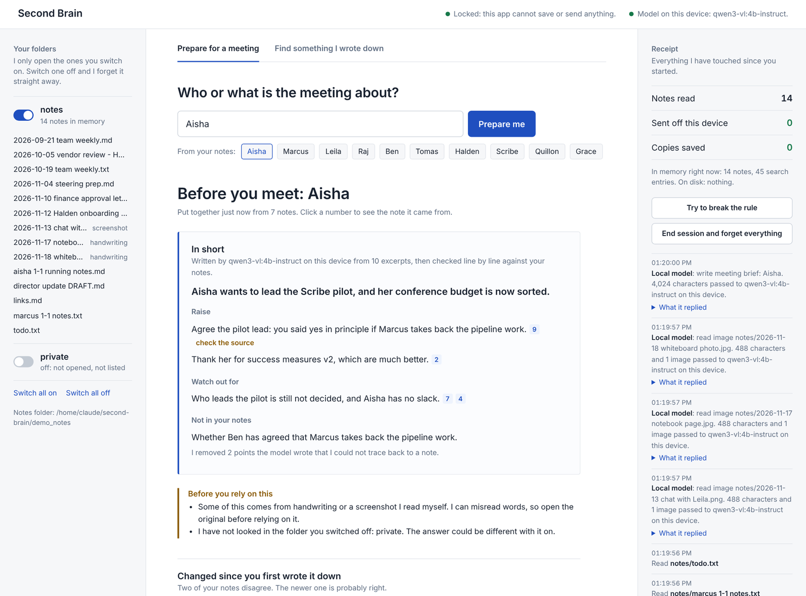

# Ctrl+Forgot

*For everything you forgot you wrote down.*

An on-device assistant that turns a manager's scattered notes into a meeting brief, without uploading, copying or keeping them.



Ctrl+Forgot reads the notes you allow it to see (text and Markdown files, Word documents, PDFs, screenshots and photos of handwriting) and prepares you for a meeting: what is still open, what was decided, what has changed since it was first written down, and what is unresolved. Every line is cited to the file, line and date it came from. A language model running locally through [Ollama](https://ollama.com) adds a short written summary, and each point in it is checked against the cited notes before it is shown.

It was built for the AI Studio hackathon brief *Second Brain for Managers*, whose one rule is that your knowledge stays yours: nothing leaves the device and no copy is kept.

## Features

- **Meeting prep.** Type a person, project or topic to get open actions (with owner and due date), decisions, open questions, recent mentions and values that changed between notes.
- **Find.** Ask a question in plain English. Answers come with the matching lines, newest first, and the app says so plainly when your notes do not answer it.
- **Change detection.** Spots when a newer note contradicts an older one (a budget cut from £60k to £45k, a start date moved) and flags the older line as superseded.
- **Completion tracking.** Matches an action in one note to a later note reporting it done, even across files and formats.
- **Verified summaries.** The model sees only numbered excerpts. Points without support in their sources, or with numbers that appear in none of the notes, are removed. Summaries stream as they are written and are labelled as drafts until verified.
- **Many formats.** `.txt`, `.md`, `.csv`, `.docx`, `.pdf` (including scanned PDFs), `.jpg` and `.png`, all read in memory with no third-party Python packages.
- **Access control.** Every folder starts switched off. Folders can require a passcode, and individual notes can be hidden.
- **Session receipt.** A live log of every file read and every request to the local model, with a self-test that attempts prohibited operations and shows them being blocked.

## Privacy model

| Guarantee | How it is enforced |
|---|---|
| **Nothing leaves the device** | A Python audit hook (PEP 578) blocks every network connection and name lookup except loopback. The model runs in Ollama on `127.0.0.1`, and cloud-hosted Ollama models are ignored. The web UI's Content Security Policy only allows same-origin resources. |
| **No copies are kept** | The same hook blocks opening files for writing and all file creation, renaming and deletion. The search index, image transcriptions and receipt exist only in memory and are rebuilt each session. Responses are sent with `Cache-Control: no-store`, and the UI uses no browser storage. |
| **The user decides what is read** | Folders are off by default. The hook refuses to open or list anything in the notes folder outside the approved set, so the restriction does not rely on the UI. Switching a folder off drops its notes from memory immediately. |
| **It can be checked** | The receipt is generated from the audit events themselves. *Try to break the rule* makes real attempts to send data, save a copy and start a process. At the end of a session, every note read is re-hashed and compared. `tools/fingerprint.py` gives an independent before/after check, and everything works with Wi-Fi off. |

### Limitations

- The guard is an in-process control over the Python standard library, not an operating-system sandbox. A production version should add OS-level isolation.
- Ollama is a separate process. Ctrl+Forgot only ever contacts it on loopback, but cannot constrain Ollama itself. Downloading a model needs the internet once.
- While a session is open, note content is held in this process's memory and in the model's memory. Both are released when the session ends.
- Passcodes control what the assistant may open; they do not encrypt files on disk.
- Handwriting recognition can be wrong. Transcriptions are always shown next to the original image and marked as read from an image.

## Requirements

- **Python 3.8 or newer.** Standard library only.
- **[Ollama](https://ollama.com)** (optional). Without it, search, meeting prep, change detection and the receipt still work; summaries and image reading need a model.

Recommended models (use the `-instruct` variants; the plain tags are reasoning models and are much slower):

| Model | Size | Use |
|---|---|---|
| `qwen3-vl:4b-instruct` | 3.3 GB | Good default for laptops: summaries and handwriting |
| `qwen3-vl:8b-instruct` | ~6 GB | Best handwriting accuracy; slower without a dedicated GPU |
| `qwen3-vl:2b-instruct` | 1.9 GB | Fastest; for machines with little GPU memory |
| `nomic-embed-text` | 0.3 GB | Optional: adds meaning-based search |

If several are installed, the smallest suitable model writes summaries and the most capable one transcribes images in the background.

## Getting started

```bash
git clone <repository-url>
cd ctrl-forgot
ollama pull qwen3-vl:4b-instruct      # optional
python run.py                          # macOS/Linux: python3 run.py
```

Open the address it prints (`http://127.0.0.1:8765`). By default it uses the notes in `sample_notes/`.

### As a desktop app

- **Windows:** double-click `Create desktop shortcut.bat` once, then use the *Ctrl+Forgot* icon on the desktop. You can also double-click `Ctrl+Forgot.pyw`.
- **macOS:** double-click `Ctrl+Forgot.command`. The first time, right-click it and choose *Open*.

The app opens in its own window. Closing the window ends the session and the process exits. Launching it again while it is running brings the existing window back.

### Command line

```
python run.py [--notes DIR] [--app] [--port 8765] [--ollama-port 11434] [--today YYYY-MM-DD]
```

`--today` fixes the reference date for relative phrases like "2 weeks ago" or "overdue", which is useful for demos.

## Configuration

Copy `settings.example.txt` to `settings.txt` (which Git ignores) and edit it there.

| Setting | Example | Purpose |
|---|---|---|
| `notes` | `notes = demo_notes` | Notes folder: absolute, or relative to the app folder |
| `today` | `today = 2026-11-23` | Fixed reference date |
| `model` | `model = qwen3-vl:2b-instruct` | Model for summaries |
| `vision_model` | `vision_model = qwen3-vl:4b-instruct` | Model for images and scanned PDFs |
| `context` | `context = 3072` | Context window for summaries (lower uses less GPU memory) |
| `protect` | `protect = private` | Comma-separated folders that need a passcode |
| `passcode` | `passcode = pbkdf2:sha256:…` | Plain, or a hash from `python tools/passcode.py` |

Each top-level folder inside the notes folder is one on/off switch in the UI. Subfolders are included with their parent. Putting the date at the start of a file name (`2026-11-12 budget call.md`) helps the app place notes in time; for running documents, a dated heading per entry (`## 14 Oct`) works too.

## How it works

1. **Load.** Approved files are read into memory. Word documents are parsed from their XML, PDFs by a built-in parser, and images and scanned PDF pages are transcribed by the local vision model in the background.
2. **Index.** Notes are split into small chunks and indexed with BM25 (with light stemming, typo tolerance and synonyms), optionally blended with local embeddings.
3. **Extract.** Rule-based extraction finds actions, owners, due dates, decisions, open questions, completion reports and changed values, each tied to a single line.
4. **Retrieve.** Queries that name an entity ("the Quillon pilot") are only answered by lines about that entity, so a name in one note and a date in another are not presented as an answer.
5. **Summarise.** The top excerpts, numbered, go to the local model with a JSON schema. The response streams to the UI as a draft.
6. **Verify.** Each point must cite excerpts that contain most of its words and all of its numbers. Unsupported points are removed, and the UI says how many.

```
run.py                     entry point and CLI
secondbrain/
  guard.py                 audit-hook enforcement of the privacy model
  session.py               folder approval, loading, transcription queue, session end
  index.py                 in-memory BM25 index
  extract.py               rule-based extraction
  dates.py                 informal date parsing
  brief.py                 meeting prep, find, and answer verification
  llm.py                   Ollama client: model selection, streaming, transcription
  pdftext.py               PDF text extraction
  passcode.py              protected-folder passcodes
  ledger.py                session receipt
  server.py                loopback HTTP server and JSON API
  desktop.py               app-window mode
web/                       UI (HTML, CSS, JavaScript; no external resources)
tools/
  fingerprint.py           independent folder fingerprint
  passcode.py              hashed passcode generator
tests/                     unit and end-to-end tests, mock Ollama server
demo_notes/                fictional notes: an AI team piloting a drafting assistant
sample_notes/              fictional notes used by the test suite
```

## Tests

```bash
python -B tests/test_all.py
```

The suite needs no network access and no model. End-to-end tests start the app against `sample_notes/` with a mock Ollama server, and check, among other things, that nothing in the repository changes during a session and that every prohibited operation is blocked.

## Sample data

Everything in `demo_notes/` and `sample_notes/` is fictional: the people, projects, vendors and figures are invented.

## Roadmap

- Operating-system sandboxing around the whole app
- Calendar and email exports as sources
- Local speech-to-text for voice memos
- Per-meeting scopes (only these folders for this 1:1)
- Signed installers for Windows and macOS
